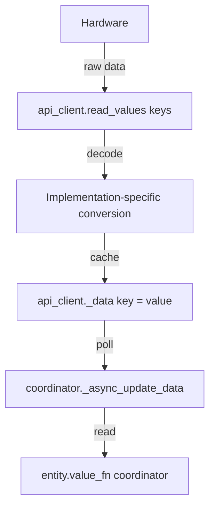
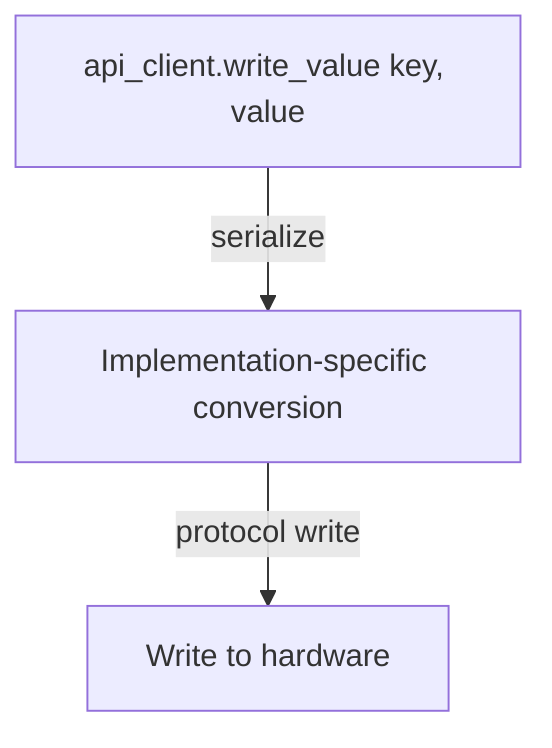

# API Layer & Data Keys

## Overview

The API layer sits between the hardware and the rest of the integration. It
exposes abstract **string keys** (e.g. `"outdoor_temp"`, `"unit_power"`) so that
the coordinator and entities never deal with protocol-specific details. How
those keys are resolved — Modbus registers, a future REST endpoint, or anything
else — is an implementation concern hidden behind the `HitachiApiClient` port.

## API Abstraction

### The Port: `HitachiApiClient`

Defined in `api/base.py`, this abstract class is the contract every gateway
client must implement. Key surface area:

| Area | Methods / Properties |
| --- | --- |
| Connection | `connect()`, `close()`, `connected` |
| Reading | `base_keys`, `gateway_keys`, `read_value(key)`, `read_values(keys)` |
| Writing | `write_value(key, value)` |
| Key capabilities | `supports_key(key)`, `can_write(key)`, `supported_unit_modes` |
| Feature detection | `has_dhw`, `has_pool`, `has_circuit(circuit_id, mode)` |
| Status flags | `is_defrosting`, `is_compressor_running`, `is_boiler_active`, ... |
| Unit control | `get/set_unit_power()`, `get/set_unit_mode()` |
| Circuit control | `get/set_circuit_target_temperature(circuit_id)`, ... |
| DHW / Pool control | `get/set_dhw_target_temperature()`, ... |

Entities interact with the coordinator and the API client through these
abstractions — they never import from `api/modbus/`.

`base_keys` and `gateway_keys` return lists of abstract keys. Sensors gate
optional data with `supports_key`; controls use `can_write`. The
`supported_unit_modes` tuple contains only writable modes (`cool`, `heat`,
`auto`): ATW-MBS-02 gen2 supports all three, while the pre-2016 variant
and HC-A(16/64)MB support only cool and heat. The control-unit select intersects its profile-dependent
options with that tuple and reports failed writes as service errors.
`register_map` is a concrete Modbus implementation detail, absent from the port.

### Configuration providers

Providers own `async_validate_connection(client)`, returning a
`ConnectionValidation` with an error key or an optional hardware ID. They
handle transport exceptions and close the validation connection. Validation
checks `ReadResult` before consuming model data: an initializing or
desynchronized gateway produces its readiness error, never `invalid_slave`.
A successful read remains authoritative, including the pre-2016 map's
nonblocking state 1.

The provider also owns `fallback_unique_id`, `configuration_url` (which may
return `None`), `same_gateway`, and `sensitive_config_keys` for diagnostics.
Modbus fallback IDs retain the exact `host_device_unit-suffix` format in both
setup and the config flow. Existing unique IDs are preserved. Pymodbus version
compatibility lives in `api/modbus/compat.py`.

### Data Keys

A **data key** is a human-readable string that identifies a value the API can
provide (e.g. `"outdoor_temp"`, `"compressor_frequency"`). Keys are grouped by
device:

| Group | Device | Example keys |
| --- | --- | --- |
| Gateway | Gateway module | `alarm_code`, `unit_model`, `system_config` |
| Control unit | Main heat pump | `outdoor_temp`, `water_inlet_temp`, `unit_power` |
| Primary compressor | Compressor #1 | `compressor_frequency`, `compressor_current` |
| Secondary compressor | Compressor #2 (S80) | `secondary_compressor_frequency` |
| Circuit 1 / 2 | Heating/cooling zones | `circuit1_power`, `circuit1_target_temp` |
| DHW | Domestic hot water | `dhw_power`, `dhw_current_temp` |
| Pool | Pool heating | `pool_power`, `pool_current_temp` |

Not every key backs an entity. Two groups of read-only version keys only feed
the device registry when the devices are registered at setup, in `__init__.py`:

- The control-unit keys `software_pcb` and `software_lcd` (the unit's board and
  controller software numbers, on all three maps: ATW-MBS-02 `1095`/`1096`,
  pre-2016 `1085`/`1084`, HC-A(16/64)MB offsets `146`/`147`) are formatted by
  `_unit_sw_version` into the Control Unit device's `sw_version`
  (`PCB H-0289 / LCD H-0272`, Hitachi's own notation: the raw decimal value,
  zero-padded to four digits behind `H-`).
- On the Before Line-up 2016 map only, the gateway keys `gateway_hw_version`
  and `gateway_sw_version` (the ATW-MBS-02's own "Hardware version" /
  "Software version", status registers `1081` / `1082`) are rendered by
  `_version_text` into the Gateway device's `hw_version` / `sw_version`. The
  Line-up 2016 map and HC-A(16/64)MB do not document an equivalent, so the keys
  do not exist there and the device carries no version.

## Data Flow

### Reading (hardware → entity)



Entity descriptions reference a key with a `value_fn` lambda:

```python
HitachiYutakiSensorEntityDescription(
    key="outdoor_temp",
    value_fn=lambda coordinator: coordinator.data.get("outdoor_temp"),
    # ...
)
```

### Writing (entity → hardware)



The API client validates that the key is writable before attempting the write.

## Modbus Implementation

The current (and only) implementation uses Modbus TCP via pymodbus. All
Modbus-specific concerns live in `api/modbus/`.

### RegisterDefinition

Every data key is backed by a `RegisterDefinition` (defined in
`api/modbus/registers/__init__.py`):

```python
@dataclass
class RegisterDefinition:
    address: int                                    # Read address
    codec: RegisterCodec                            # Raw word <-> value, both ways (required)
    write_address: int | None = None                # Write address if different from read
    fallback: RegisterDefinition | None = None      # Fallback register if primary decodes to None
    sentinel_values: frozenset[int] | None = None   # Decoded values that mark the sensor as absent
    keep: Keep | None = None                        # Value the hardware forgets on reboot, written back
```

- `codec` — required: a register is never read or written raw (#533). See
  [Register codecs](#register-codecs).
- `write_address` — used when the read and write addresses differ (HC-A(16/64)MB
  gateway).
- `fallback` — an alternative register tried when the primary returns `None`
  (a read error, or a word the codec decodes to `None`, e.g. `0xFFFF` on the
  unsigned HP-level water outlet).
- `keep` — marks a value the hardware forgets on reboot (#511). The restore
  is mechanical: `KeptValues` (`api/modbus/kept_values.py`, pure, no I/O)
  never interprets a value. It keeps a reference (the last value written, or
  the last reading that is not lost) and, when a successful read shows the
  value lost (a reading of 0, or outside `Keep.valid_range`), plans a
  write-back that the client executes through the register codec, like any
  write. A persisted reference is only trusted when the codec writes it back
  unchanged (`decode(encode(value)) == value`). Two declarative links order
  the restore, checked by `validate_kept_registers` when the client starts
  (along with every kept register being writable):
  - `Keep.while_on` names a kept value this one depends on (an enable flag).
    The dependent is only written back while that value reads non-zero or is
    lost too.
  - `Keep.seed_from` names a kept value to copy instead of a reference (the
    source's reference, or its reading when that is right). A seeded value
    has no reference of its own, so nothing is persisted on every update.

  One rule orders everything: a value waits until all the values that must
  go before it read right and are confirmed, namely the values that depend
  on it (`while_on`) and the values seeded from it (`seed_from`). A plan
  never depends on the outcome of writes made in the same pass. On a full
  power cut this gives three steps, each confirmed by the unit before the
  next: the seeded room value, then the target, then the flag. A failure
  along the way leaves the state the reboot left (target 0, unit idle),
  never a target over a room value of 0, and a CONTROL-only flag, which
  reads back what was written, only goes up once STATUS registers prove
  the unit applied its dependents.

  A value lost with no reference while what it depends on is on, or a value
  whose prerequisites cannot be restored, is reported rather than written,
  re-evaluated on every read and logged once. A value also waits while one
  of its prerequisites went unread. A write-back is confirmed through the
  pending-write shadow and abandoned after `MAX_RESTORE_ATTEMPTS` (3);
  `restore_failed` stays true until the values read right or Home Assistant
  writes them. `read_values` never writes: it updates the references and
  queues the lost values, and the coordinator calls `restore_lost_values()`
  after each successful read, once the unit is verified (a no-op when
  nothing was lost). A read that fails, or finds the gateway `initializing`
  or `desynchronized`, queues nothing. The references go through the port
  (`kept_values()`, `restore_kept_values()`, `listen_kept_values()`); the
  coordinator persists them in a `Store`
  (`hitachi_yutaki_kept_values_{entry_id}`), loaded before the first poll and
  saved shortly after every reference change, and raises the generic
  `kept_values_restore_failed_{entry_id}` issue. The issue is fixable: its
  fix flow calls `retry_restores()` (a fresh set of attempts) and polls at
  once, and the next poll raises it again if the values still do not stick.

  On the 2016 ATW-MBS-02 map the kept values are, per circuit, the
  "Thermostat Available" flag (1010 / 1021), the room target (1060 / 1072,
  5.0-35.0 °C, `while_on` the flag) and the room value (1061 / 1073,
  `while_on` the flag, `seed_from` the target): room equals target keeps the
  unit idle until Home Assistant writes the real temperature, and a room
  value that survived the reboot is not touched.

### CONTROL vs STATUS Registers

Hitachi gateways expose two logical register ranges:

- **CONTROL** (R/W) — commands sent to the heat pump.
- **STATUS** (R) — actual state read back from the heat pump.

Register definitions must point to **STATUS addresses for reads**. Reading a
CONTROL register only tells you what was last *commanded*, not the actual
running state. This is handled entirely within the register map files — entity
code does not need to know about this distinction.

The gateway acknowledges a CONTROL write at once, but the matching STATUS
register only follows once the command has gone over H-LINK to the unit and
back (15–20 s on an ATW-MBS-02). So that a command does not show up, revert and
show up again, a successful `write_value` publishes the expected value (the
written raw word decoded by the key's codec) immediately and ignores
STATUS reads of that key that still report another value, for up to
`PENDING_WRITE_TTL` (30 s). A read equal to the expected value confirms the
write and lifts the shadow earlier; past the deadline the gateway value wins
again, so a command the unit refused cannot stick. Failed writes publish nothing.

Two known limits of the shadow:

- A fast **A → B → A** sequence on one key: the expected value is A again, so a
  poll still reporting the first A counts as the confirmation. If the unit had
  picked up B in between, STATUS can briefly show B.
- Keys that **share a STATUS register** (`dhw_high_demand`, writable, and
  `dhw_demand_mode`, read-only, both at 1079 on the ATW-MBS-02): only the written
  key is shadowed, so the two entities can disagree during the window.

### Gateway Register Maps

Each gateway has its own register map implementation:

| Gateway | File | Addressing |
| --- | --- | --- |
| ATW-MBS-02 | `api/modbus/registers/atw_mbs_02.py` | Absolute addresses (1000–1231) |
| HC-A(16/64)MB | `api/modbus/registers/hc_a_mb.py` | Computed: `5000 + (unit_id × 200) + offset` |

Both implement `HitachiRegisterMap` (ABC in `api/modbus/registers/__init__.py`)
which defines register dictionaries, bitmasks for feature detection, and
writable key sets.

### Register codecs

The `api/modbus/registers/codecs/` package holds one file per codec: the
`RegisterCodec` protocol (`protocol.py`), `unsigned.py`, `signed.py`,
`scaled.py`, `enum_codec.py`, `prefixed.py` and `hca_unit_mode.py`, plus
`catalog.py` for the value lists every map shares (`SWITCH`, states, OTC
methods, unit models). Import them from the package. A codec converts both ways: `decode(raw)` on read,
`encode(value)` on write, and guarantees `decode(encode(value)) == value` for
every value `encode` accepts (pinned by `test_every_register_round_trips`).
`encode` raises for a value the register cannot hold, so `write_value` refuses
it before anything reaches the gateway. Writers therefore pass the value the
integration stores (22.5 °C, `"points"`, 1), never a raw word.

| Codec | Register type | `decode` | `encode` |
| --- | --- | --- | --- |
| `UNSIGNED` | Quantity (frequency, opening, setpoint in °C) | word, `0xFFFF` → `None` | whole value in 0~65534 |
| `SIGNED` | Signed quantity, marked (*1) | two's complement, `0xFFFF` → `-1` | two's complement |
| `TENTHS` (`Scaled(10)`) | Tenths (*3), pressures in hundredths of MPa = tenths of bar | `253` → `25.3`, `0xFFFF` → `None` | `round(value × 10)` |
| `EnumCodec` | Closed list: `SWITCH` (0/1), unit mode, central mode, states, OTC methods, unit model | documented word → value, else `unknown` (default `None`) | value → word, else `ValueError` |
| `Prefixed` | Alarm code as translation key | `42` → `"alarm_code_42"`, `0xFFFF` → `None` | key → code |

Pick the codec from the register's documented type. A register whose values
are a list (run/stop, a mode) is an `EnumCodec`, not `UNSIGNED`: a garbage
word such as `0xFFC0` (seen in the fleet) then reads as no value instead of
as a mode. Each map instantiates its own `UNIT_MODE` and `UNIT_MODEL` from
the shared classes (the documented values differ). `HcaUnitMode` is only used
by HC-A(16/64)MB: it reads the STATUS bit field (offset 101: B0 cool/heat,
B1 auto) and writes the CONTROL value (offset 51: 0 cool, 1 heat, no auto).

### Sentinel Values

Sentinels are decoded values that mean the sensor or module is **absent**:

| Raw value | Decoded | Meaning |
| --- | --- | --- |
| `0xFF81` | -127 (signed) | Temperature sensor disconnected |
| `0xFFBD` | -67 (signed) | DHW temperature sensor disconnected |

They are matched against `RegisterDefinition.sentinel_values` in the read loop
*after* decoding; the key is removed and the fallback is not read.

`0xFFFF` is not a sentinel. On a **signed** register it is `-1` in two's
complement, and the gateway documentation defines no sensor-error value for
these registers, so `SIGNED` decodes it as `-1` (#533: a reading of exactly
-1 °C used to become `unknown`). On every other register it is outside the
documented range or list, so the codec decodes it to `None`, which also
triggers the fallback. The HP-level water outlet (`1200`, before line-up 2016
`1199`) is one of them: unsigned, 0~100 °C, Yutaki S & S Combi only, so the
circuit outlet fallback (`1093`/`1080`, signed) is read on other models. A
gateway that returns `0xFFFF` everywhere because it receives no heat pump
data is caught earlier, by the `system_state` preflight (`no_data_warning`).

### Concrete Examples

Read-only register (ATW-MBS-02):

```python
"outdoor_temp": RegisterDefinition(1091, SIGNED),
```

Writable register with separate read/write addresses (ATW-MBS-02), stored as
integer degrees:

```python
"pool_target_temp": RegisterDefinition(1082, UNSIGNED, write_address=1029),
```

Writable register with separate read/write addresses (HC-A(16/64)MB):

```python
"unit_power": RegisterDefinition(
    self._addr(100), SWITCH, write_address=self._addr(50)
),
```

Register with fallback:

```python
"water_outlet_temp": RegisterDefinition(
    1200,  # unsigned 0~100 °C, 0xFFFF = not exposed
    UNSIGNED,
    fallback=RegisterDefinition(1093, SIGNED),
),
```

## Adding a New Data Point

1. **Find the hardware address** in the gateway documentation
   (see [gateway docs](../gateway/)).

2. **Add a `RegisterDefinition`** to the appropriate `REGISTER_*` dictionary in
   the gateway's register file (`api/modbus/registers/`). Choose the correct
   group based on which device the data belongs to.

3. **Pick its codec** from the documented type (see
   [Register codecs](#register-codecs)). Reuse a shared codec; add one to
   `codecs/` (one file) only for a new type of value, or to `catalog.py` for a
   new shared list of values.

4. **If the data point is writable**: add the key to the `WRITABLE_KEYS` set.
   Its codec encodes the writes; check that it accepts every value the entity
   can send.

5. **Create an entity description** in the appropriate `entities/<domain>/`
   builder, referencing the key via `coordinator.data.get("key")`. See
   [Adding Entities](adding-entities.md).

6. **If the data point is model-specific**: add the key to the profile's
   `extra_register_keys` list (see [Profiles](profiles.md)).

## Further Reading

- [Gateway hardware documentation](../gateway/) — register addresses and
  footnotes from the manufacturer PDF
- [Profiles](profiles.md) — how model-specific data points are selected
- [Architecture overview](../architecture.md) — hexagonal architecture and
  layer boundaries
